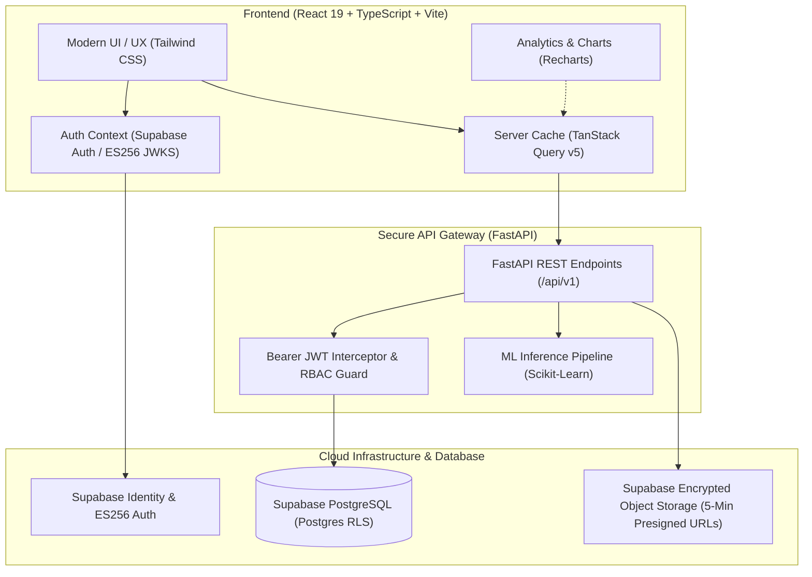

# 🌿 WellTree (Family Health Guardian)

<div align="center">

[](https://opensource.org/licenses/MIT)
[](https://react.dev/)
[](https://www.typescriptlang.org/)
[](https://vitejs.dev/)
[](https://fastapi.tiangolo.com/)
[](https://supabase.com/)
[](https://tailwindcss.com/)
[](https://scikit-learn.org/)

<br />

### *"One Family. One Health Center. One Trusted Guardian."*

**WellTree** is an enterprise-grade, consent-driven healthcare ecosystem and AI-powered diagnostic hub. It enables families to collaboratively coordinate clinical records, automate medication adherence, dispatch emergency SOS with GPS geolocation, and leverage machine learning to predict chronic disease risks—all within a zero-trust, privacy-first boundary.

[Explore Features](#-core-capabilities) • [Live Architecture](#-system-architecture) • [Quick Start](#-quick-start) • [API Overview](#-backend-api-landscape) • [Security & RBAC](#-zero-trust-privacy--rbac)

</div>

---

## 🌟 Why WellTree?

Managing family healthcare today is fragmented across disparate clinic portals, paper reports, and uncoordinated caregiving. When an emergency strikes, vital information—blood types, active allergies, medication schedules, and clinical histories—is rarely at hand.

**WellTree** bridges this divide by providing:
- **Unified Care Circles**: Connect elderly parents, dependents, and guardians under role-aware governance.
- **Granular Mutual Consent**: No record is accessed without explicit, revocable cryptographic authorization.
- **Clinical AI Intelligence**: Proactive disease early-detection models (Diabetes stacking & Hypertension classifiers, multi-symptom diagnostics).
- **Critical Emergency Response**: Instant one-click SOS broadcast with live geolocation coordinates.

---

## 🚀 Core Capabilities

<table>
  <tr>
    <td width="50%" valign="top">
      <h3>🛡️ Zero-Trust Family Hub & Consent</h3>
      <ul>
        <li><b>Dynamic Family Circles</b>: Organize members with strict RBAC (<code>ADMIN</code>, <code>GUARDIAN</code>, <code>MEMBER</code>).</li>
        <li><b>Mutual Consent Lifecycle</b>: Granular <code>READ_ONLY</code> vs <code>FULL_ACCESS</code> delegations with approval, rejection, and revocation controls.</li>
        <li><b>Row-Level Security (RLS)</b>: Supabase database policies guarantee absolute tenant and family isolation.</li>
      </ul>
    </td>
    <td width="50%" valign="top">
      <h3>🧠 Tri-Engine Clinical Machine Learning</h3>
      <ul>
        <li><b>Diabetes Risk Stacking</b>: Ensemble ML classification evaluating glycemic markers, BMI, and genetic risk factors.</li>
        <li><b>Hypertension Risk Engine</b>: Cardiovascular screening calculating risk scores and prioritized risk drivers.</li>
        <li><b>Multi-Disease Symptom Checker</b>: Diagnostic inference engine analyzing symptom clusters and clinical indicators.</li>
      </ul>
    </td>
  </tr>
  <tr>
    <td width="50%" valign="top">
      <h3>🚨 Emergency SOS & Geolocation</h3>
      <ul>
        <li><b>One-Touch SOS Dispatch</b>: Immediate high-priority incident broadcast to pre-configured emergency contacts.</li>
        <li><b>Live GPS Coordinates</b>: Automatically embeds reverse-geocoded coordinates into the alert beacon.</li>
        <li><b>Incident Lifecycle & History</b>: Timestamped logs with status tracking from active alert to confirmed resolution.</li>
      </ul>
    </td>
    <td width="50%" valign="top">
      <h3>💊 Smart Adherence & Prescription Catalog</h3>
      <ul>
        <li><b>Medication Tracking</b>: Catalog dosages, frequencies, food instructions, and prescribing physicians.</li>
        <li><b>Adherence Schedules</b>: Log intake status (<code>TAKEN</code>, <code>SKIPPED</code>, <code>MISSED</code>) to optimize clinical outcomes.</li>
        <li><b>Intelligent Reminders</b>: In-app notification center for pending doses and prescription refills.</li>
      </ul>
    </td>
  </tr>
  <tr>
    <td width="50%" valign="top">
      <h3>📑 Secure Medical Vault</h3>
      <ul>
        <li><b>Encrypted Document Storage</b>: Store lab reports, imaging files, and discharge summaries in Supabase Storage.</li>
        <li><b>Ephemeral Access</b>: Automatically generated 5-minute pre-signed URLs prevent unauthorized sharing.</li>
        <li><b>Categorized Tagging</b>: Filter by test type, date, issuing lab, and associated condition.</li>
      </ul>
    </td>
    <td width="50%" valign="top">
      <h3>📈 Longitudinal Analytics & Audit Trail</h3>
      <ul>
        <li><b>Biometric Trajectories</b>: Visual trend charts (blood glucose, blood pressure, BMI) powered by Recharts.</li>
        <li><b>Immutable Audit Logging</b>: Complete historical trace of record views, consent changes, and data exports.</li>
        <li><b>One-Click Biometric Auto-Prefill</b>: Seamlessly pipe recent lab vitals into diagnostic ML models.</li>
      </ul>
    </td>
  </tr>
</table>

---

## 🏗 System Architecture

WellTree operates on an asynchronous, decoupled client-server architecture built for security, high throughput, and clinical reliability.



---

## 💻 Tech Stack

### **Frontend Client**
- **Core Framework**: React 19, TypeScript, Vite
- **Data Fetching & Cache**: [TanStack Query v5](https://tanstack.com/query/latest) (optimistic updates, automatic cache invalidation)
- **Routing**: [React Router v7](https://reactrouter.com/) (declarative protected & guest route boundaries)
- **Styling**: [Tailwind CSS v3](https://tailwindcss.com/) with a custom clinical design system
- **Forms & Validation**: [React Hook Form](https://react-hook-form.com/) + [Zod](https://zod.dev/)
- **Visualizations**: [Recharts](https://recharts.org/) (longitudinal biometric tracking)
- **Icons & Alerts**: [Lucide React](https://lucide.dev/), [React Hot Toast](https://react-hot-toast.com/)

### **Backend & Machine Learning Services**
- **API Framework**: [FastAPI](https://fastapi.tiangolo.com/) (Python 3.10+)
- **Authentication**: Supabase JWT (ES256 asymmetric ECDSA signing via JWKS)
- **Database**: PostgreSQL with Row-Level Security (RLS)
- **Storage**: Supabase Storage Buckets (ephemeral pre-signed URLs)
- **Machine Learning**: [Scikit-Learn](https://scikit-learn.org/), NumPy, Pandas (Ensemble Stacking Classifiers)

---

## ⚡ Quick Start

### 1. Prerequisites
- **Node.js**: `v18.0.0` or higher
- **npm** or **yarn** / **pnpm**
- **Python**: `3.10+` (for local backend service)
- **Supabase Account**: An active Supabase project with Email Auth enabled

---

### 2. Installation & Setup

#### **Clone the Repository**
```bash
git clone https://github.com/lycants06r/WELLTREE-TRAIL.git
cd WELLTREE-TRAIL
```

#### **Configure Environment Variables**
Copy the sample environment file in the `frontend` directory:
```bash
cp frontend/.env.example frontend/.env
```

Update `frontend/.env` with your project credentials:
```env
# Backend Service URL
VITE_API_BASE_URL=http://127.0.0.1:8000/api/v1

# Supabase Credentials
VITE_SUPABASE_URL=https://your-project.supabase.co
VITE_SUPABASE_ANON_KEY=your-supabase-anon-key
```

#### **Install Frontend Dependencies**
```bash
cd frontend
npm install
```

#### **Run the Local Development Server**
```bash
npm run dev
```
Open your browser and navigate to `http://localhost:5173`.

---

## 📂 Repository Structure

```text
WELLTREE-TRAIL/
├── backend/
│   └── frontend_requirements.txt   # Complete backend API contracts, ML schemas & specifications
├── frontend/
│   ├── public/                     # Static assets, SVG favicons
│   ├── src/
│   │   ├── components/             # Reusable clinical UI primitives, layout wrappers, modals
│   │   │   ├── auth/               # Route guard components
│   │   │   ├── consents/           # Mutual consent approval/revocation dialogs
│   │   │   ├── families/           # Family cards, roster managers, invite flows
│   │   │   ├── layout/             # Navbar, Sidebar, DashboardLayout, Footers
│   │   │   ├── profile/            # User avatar, completion meter, clinical tags
│   │   │   └── ui/                 # Buttons, Inputs, Cards, Badges, Modals, ErrorBoundaries
│   │   ├── context/                # AuthContext, FamilyContext, NotificationContext
│   │   ├── hooks/                  # TanStack Query custom hooks (useAuth, useConsents, etc.)
│   │   ├── lib/                    # Axios client with JWT interceptor, Supabase client, utils
│   │   ├── pages/                  # 20+ feature-rich page views
│   │   │   ├── LandingPage.tsx     # Hero overview, features, call-to-action
│   │   │   ├── DashboardPage.tsx   # Centralized vitals, stats, and quick actions
│   │   │   ├── FamiliesPage.tsx    # Family hub directory & member rosters
│   │   │   ├── ConsentsPage.tsx    # Dual-tab consent control center
│   │   │   ├── HealthRecordsPage.tsx# Electronic health record tracking
│   │   │   ├── EmergencySOSPage.tsx# GPS SOS beacon trigger & active alerts
│   │   │   ├── MedicinesPage.tsx   # Medication catalog & adherence schedules
│   │   │   ├── MedicalReportsPage.tsx# Secure medical document viewer
│   │   │   ├── DiabetesPredictionPage.tsx # Ensemble ML risk assessment
│   │   │   ├── HypertensionPredictionPage.tsx # Blood pressure ML risk scoring
│   │   │   ├── SymptomCheckerPage.tsx # Diagnostic symptom assessment
│   │   │   └── AuditLogsPage.tsx   # Tamper-evident HIPAA audit trail
│   │   ├── styles/                 # Tailwind design tokens & globals
│   │   └── types/                  # Strict TypeScript interfaces & models
│   ├── package.json
│   ├── tailwind.config.js
│   └── vite.config.ts
└── README.md
```

---

## 📡 Backend API Landscape

The frontend seamlessly communicates with over 45+ RESTful endpoints exposed by the FastAPI engine:

| Module | Core Endpoints | Functionality |
| :--- | :--- | :--- |
| **Authentication & Profiles** | `GET /profiles/me`, `PUT /profiles/me` | User synchronization, biometric identity, contact details |
| **Family Circles & Roles** | `GET /families`, `POST /families`, `GET/POST /families/{id}/members` | Family management, admin permissions, member assignment |
| **Consent Governance** | `GET /consents`, `POST /consents`, `PATCH /consents/{id}` | Mutual consent requests, approve (`ACTIVE`), deny, revoke |
| **Health Records** | `GET /health-records`, `POST /health-records` | Vitals logging (blood pressure, glucose, weight, allergies) |
| **Prescriptions & Intake** | `GET /medicines`, `POST /medicine-schedules`, `POST /medicine-logs` | Medication adherence tracking and intake reminders |
| **Medical Reports** | `GET /medical-reports`, `POST /medical-reports/upload-url` | Secure cloud document upload & 5-minute pre-signed links |
| **Emergency SOS & GPS** | `POST /emergency-sos`, `GET /emergency-sos/active` | Real-time GPS coordinate broadcast and responder alerting |
| **AI Disease Predictions** | `POST /predictions/diabetes`, `POST /predictions/hypertension` | Stacking classifier inference, risk scores & driver attribution |
| **Audit & Governance** | `GET /audit-logs` | Tamper-evident access history and security event tracking |

---

## 🛡️ Zero-Trust Privacy & RBAC

WellTree is built with privacy-by-design at every layer:

```
+---------------+---------------------+--------------------+--------------------+
| Role          | Manage Family Group | View Vitals/Logs   | Trigger SOS Beacon |
+---------------+---------------------+--------------------+--------------------+
| ADMIN         | Full Control        | With Consent       | Yes                |
| GUARDIAN      | View Roster         | With Consent       | Yes                |
| MEMBER        | View Circle         | Self Only          | Yes                |
+---------------+---------------------+--------------------+--------------------+
```

- **Row-Level Security (RLS)**: Enforces that even direct database queries cannot return data outside of verified family and consent boundaries.
- **Short-Lived Media Links**: Sensitive health documents are never exposed via static public URLs; time-limited signed tokens expire automatically.
- **Audited Access**: Every read, write, and export event is logged with actor identification, timestamp, and context.

---

## 📜 Available Scripts

In the `frontend` directory, you can execute:

| Command | Action |
| :--- | :--- |
| `npm run dev` | Starts the Vite dev server with Hot Module Replacement (HMR) at `http://localhost:5173` |
| `npm run build` | Compiles TypeScript and packages optimized production assets to `dist/` |
| `npm run preview` | Locally serves and previews the production build |
| `npm run lint` | Runs [Oxlint](https://oxc-project.github.io/) for high-speed JavaScript/TypeScript linting |

---

## 🤝 Contributing

Contributions, feedback, and feature proposals are welcome!
1. Fork the Project.
2. Create your Feature Branch (`git checkout -b feature/AmazingFeature`).
3. Commit your Changes (`git commit -m 'Add some AmazingFeature'`).
4. Push to the Branch (`git push origin feature/AmazingFeature`).
5. Open a Pull Request.

---

<div align="center">

Built with care for families, caregivers, and modern healthcare.  
**&copy; 2024 WellTree (Family Health Guardian). All rights reserved.**

</div>
